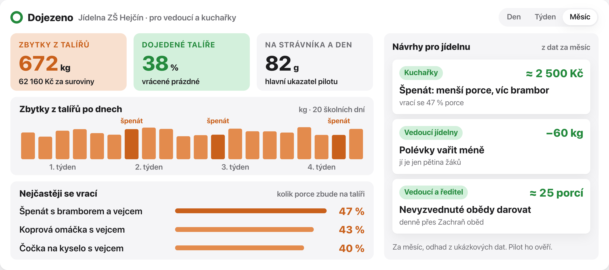

# Dojezeno

**Jídelna konečně uvidí, co děti nejedí.** Kamera nad výdejním pásem vyfotí talíř, váha pod kbelíkem zjistí, kolik se vyhodilo, a AI z toho udělá přehled a návrhy pro kuchařky a vedoucí jídelny.

[](https://moderniobec.cz/studenti-z-olomouce-navrhli-jak-s-pomoci-umele-inteligence-omezit-plytvani-jidlem/)
[](https://dojezeno.netlify.app)
[](https://dojezeno.netlify.app/onepager/dojezeno-onepager.pdf)

<p align="center">
  
</p>

S tímhle projektem jsme **vyhráli Hack Prague 2026**, který pořádala [Kokoza](https://www.kokoza.cz/projekty/hack-prague-od-napadu-k-zivejsimu-mestu/) od 30. října do 1. listopadu 2026. Soutěžilo 39 mladých lidí v osmi týmech a my jsme porotě ukázali celý řetězec: problém podložený čísly, živé demo, které rozpozná talíř z fotky z mobilu, pilot, rozpočet a rizika. Za první místo jsme získali **50 000 Kč na realizaci**, takže Dojezeno **opravdu postavíme**: šestitýdenní pilot v jídelně naší školy v Olomouci-Hejčíně začne v **lednu 2027**.

📰 Psali o nás: [Moderní obec – Studenti z Olomouce navrhli, jak s pomocí umělé inteligence omezit plýtvání jídlem](https://moderniobec.cz/studenti-z-olomouce-navrhli-jak-s-pomoci-umele-inteligence-omezit-plytvani-jidlem/)

**[Web a prezentace](https://dojezeno.netlify.app)** · **[One-pager](https://dojezeno.netlify.app/onepager/dojezeno-onepager.pdf)** · **[Obsah prezentace a zdroje čísel](prezentace/OBSAH.md)**

## Proč

| | |
|---|---|
| Kolik uvařeného jídla školní jídelny vyhodí | **téměř třetinu (31 %)** |
| Z toho zbytky z talířů | **48 %** |
| Škola s 500 žáky vyhodí jen ze zbytků na talířích jídlo za | **asi 600 000 Kč ročně** (jen suroviny) |
| Nejméně dojídané jídlo: špenát s bramborem a vejcem | **zbude skoro polovina porce** |

Zdroj: Prague Food Waste 2024 (Zachraň jídlo, Mendelova univerzita). Výzkumníci museli vážit ručně, jen asi týden. Dojezeno měří každý den automaticky. Všechna čísla i se zdroji jsou v [OBSAH.md](prezentace/OBSAH.md).

## Spuštění dema

Vyžaduje Python 3.9+, OpenSSL a moderní prohlížeč. Webové rozhraní nevyžaduje build ani instalaci JavaScriptových knihoven.

```sh
cd demo
python3 tools/set_api_key.py
python3 tools/serve.py
```

Na počítači otevřete http://localhost:8080. V prezentaci klikněte na **Mobil** a připojte telefon podle [návodu](demo/PHONE.md). Telefon a počítač musí být ve stejné místní síti; pro kameru telefonu je potřeba důvěryhodné HTTPS. Klíč Claude, certifikáty a párovací tokeny jsou pouze v ignorovaném `demo/.local/` a do repozitáře nepatří.

Po vložení talíře aplikace odešle snímek do Claude API, rozpozná jídlo a přečte čitelný displej váhy. Váhu před každým měřením vytárujte s prázdným talířem. Druhý snímek porovná s referenční porcí. **Celková hmotnost pochází z váhy; gramy jednotlivých složek jsou označené odhady AI z fotky, nikoli samostatná měření.** Živá analýza vyžaduje API kredit a internet; API chyby nenahrazuje připravenými výsledky.

Podrobnosti: [ovládání a implementace](demo/README.md), [Claude API](demo/CLAUDE.md).

## Prezentace

Otevřete `prezentace/index.html` v Chromu. První šipka doprava nebo mezerník spustí úvodní film; po dohrání sám přejde na titul s 3D modelem. Návrat šipkami úplně na začátek film zastaví a přetočí. Další šipka doprava ho znovu spustí; během přehrávání jej další stisk přeskočí. Mezerník/klikr posouvá, šipka vlevo vrací, F zapíná celou obrazovku, N poznámky a stopky. Lokální vložené demo vyžaduje server na localhost:8080. Samostatné slajdy běží i offline. Prezentace byla na přání vrácena do předchozí podoby; úvod 1.1 a původní pátý slajd ukazují jeden pás a jeden vážený kbelík. Za závěrem (#13) je rozšířená třípásová sestava pro dotazy. Hlavní část má 13 slajdů podle hodnoticích kritérií Hack Prague (včetně zapojení lidí, realizace a toho, jak jsme pracovali), živé demo je na #5. Samostatný one-pager a návrh šestitýdenního pilotu zůstávají uložené zvlášť.

```sh
cd prezentace
python3 build.py
```

`index.html` je sestavený soubor; upravujte `slajdy/`, `css/`, `js/` a `index.template.html`. Zdrojové 3D scény jsou v `model3d-src/src/`, sestavené bundly už jsou součástí repozitáře. K jejich změně je potřeba nainstalovat závislosti z `model3d-src/package-lock.json` a postupovat podle [předávky](docs/HANDOFF-codex.md).

## Netlify Drop

Projekt [dojezeno.netlify.app](https://dojezeno.netlify.app) je propojený s GitHub repozitářem `ondrej-cloud/dojedeno-hack-prague-2026`, produkční větev `main`. Soubor `netlify.toml` nastavuje build příkaz a publikování pouze složky `netlify-drop`. Po pushi Netlify sestaví prezentaci, frontend dema a one-pager. K samotnému sestavení není potřeba API klíč ani proměnné prostředí.

```sh
python3 prezentace/build.py
python3 tools/export_netlify.py
```

Do Netlify Drop přetáhněte celou složku `netlify-drop`; připravený je také `netlify-drop.zip` se souborem `index.html` přímo v kořeni. Balíček obsahuje prezentaci, demo a one-pager; ruční Drop nevyžaduje další build. Veřejný návštěvník uvidí ukázkový režim. Chráněný živý režim propojí mobilní kameru s backendem na Macu přes HTTPS tunel. API klíče, certifikáty a serverové soubory se neexportují. Export samotný nic nepublikuje.

Pro otevření připojené prezentace použijte z kořene projektu:

```sh
python3 tools/open_live_demo.py
```

V demu klikněte **Mobil** a naskenujte QR telefonem. Telefon a počítač mohou být na různých sítích. **Mac se serverem, bránou a tunelem musí zůstat zapnutý a online.** Skript otevře přístupový odkaz; sám služby nespouští. Postup včetně restartu je v [LIVE-NETLIFY.md](demo/LIVE-NETLIFY.md). Denní a měsíční data zůstávají ukázková i při živé analýze talíře.

## Pilot a podklady

První pilot navrhujeme v naší škole v Hejčíně v Olomouci (Olomoucký kraj): šest týdnů po souhlasu školy, instalaci a ověření měření. Dva týdny měření výchozího stavu, dva týdny první změna a dva týdny ověření nebo druhá varianta; nejvýše dvě iterace opatření. Rozpočet **16 000 Kč** je pracovní odhad pro jednu jídelnu, včetně vybavení, vymezené práce týmu a rezervy. Není to cenová nabídka ani schválené financování.

Hlavní návrh používá **jeden pás, fotografii talíře před vysypáním a jeden vážený kbelík**. Pořadí lze použít jen při zachování pořadí vysypávání. Souběhy a nejistoty zůstávají společnou dávkou. Hejčín má podle zadání tři patra pásu; možnost vymezit jeden sledovaný tok ještě potřebuje ověření. Tento návrh je podkladem pro one-pager; hlavní prezentace používá jeden pás, třípásové rozšíření je v záloze. Živé demo rozpoznává talíř a čte displej váhy; produkční párování s kbelíkem zatím nepředvádí.

Hlavní KPI jsou gramy vráceného potravinového gastroodpadu na skutečně vydaný oběd ve stejné sledované části provozu. Návrhový cíl −10 % není dosažený výsledek. Nevydané pokrmy sledujeme odděleně včetně dalšího využití; nemusí všechny skončit jako odpad. Finanční přínos je vedlejší a musí se prokázat zvlášť: 60 000 Kč je modelová hodnota 10 % z odhadovaných surovin ve zbytcích, nikoli automatická úspora nákupů.

- [Obsah obnovené prezentace](prezentace/OBSAH.md)
- [One-pager v PDF](materialy/onepager/dojezeno-onepager.pdf), [HTML pro tisk](materialy/onepager/index.html)
- [Prezentace online](https://dojezeno.netlify.app), [one-pager online](https://dojezeno.netlify.app/onepager/dojezeno-onepager.pdf)

Dosud není potvrzen souhlas školy, přesný termín, jednopásové místo ani dodavatelské ceny. Podporu Hack Prague mimo Prahu musí potvrdit organizátoři. Kokoza a Zachraň jídlo jsou organizace, které chceme oslovit. Chybí skutečná citace člověka z jídelny a úplná obsahová šablona organizátorů; netvrdíme úplnou shodu se šablonou ani hotovou produkční instalaci.

Denní a měsíční přehledy dema jsou **ukázková data**: 92,5 Kč/kg, ukázkový den 70 kg, bez emisních přepočtů. Zadání těchto oprav je v [codex-oprava-dat.md](docs/codex-oprava-dat.md).

## Testy

```sh
python3 demo/tools/test_demo_data.py
python3 demo/tools/test_claude_client.py
python3 demo/tools/test_claude_server.py
python3 demo/tools/test_live_gateway.py
node demo/tools/test_presence.cjs
```

Browser testy `demo/tools/verify_*.cjs` používají lokální Chrome na macOS a Playwright (balíček lze zadat proměnnou `PLAYWRIGHT_MODULE`). Testy Claude používají náhradní odpovědi, neúčtují API požadavky. **`benchmark_models.py` naopak výslovně volá placené API** nad dodanou fotografií.

## Tým

| | Na čem dělal |
|---|---|
| **Ondra** ([ondrej-cloud](https://github.com/ondrej-cloud)) | prototyp, živé demo a prezentace |
| **Tobias** ([tobiaszlobias](https://github.com/tobiaszlobias)) | research a data, mentoři, technické řešení |

Díky Kokoze, mentorům a porotě Hack Prague za zadání, rady a podporu realizace.

---

**In English.** Winning project of Hack Prague 2026 (organized by Kokoza, 30 Oct – 1 Nov 2026, 39 participants in 8 teams). Dojezeno measures plate waste in school canteens: a camera above the tray belt photographs each plate, a scale under the bin weighs what was thrown away, and AI turns it into daily and monthly reports with concrete suggestions for cooks and canteen managers. The first prize of 50 000 CZK funds a six-week pilot in our school canteen in Olomouc-Hejčín starting January 2027.
